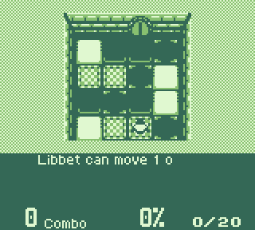

# gameboy-emu

[](https://github.com/Nell-Kh/gameboy-emu/actions/workflows/ci.yml)

A Game Boy (DMG) emulator in C++20. Work in progress.



*[Libbet and the Magic Floor](https://github.com/pinobatch/libbet) by Damian Yerrick (zlib
licence), playing its built-in demo in this emulator's SDL window. Recorded from the window with
ffmpeg.*

Libbet and the Magic Floor runs; see [docs/accuracy.md](docs/accuracy.md) for what is verified.

**Status:** CPU, timing, memory and MBC1 complete (`v0.2.0`). M3 complete (`v0.3.0`): the PPU draws
the background, window and objects, and ROMs run in an SDL window with keyboard input. Blargg's
`cpu_instrs`, `instr_timing` and `mem_timing`, 81 Mooneye tests, and dmg-acid2, mbc3-tester and
the three rtc3test subtests (pixel-identical) pass in CI. M4, cartridges and saves, is in progress:
MBC5 and MBC3 with its clock are in, and battery saves are kept in `game.sav`. There is no sound
yet, and cartridges with no mapper, MBC1, MBC3 or MBC5 load; see [docs/accuracy.md](docs/accuracy.md)
for exactly what is and is not covered.

## Build and test

Needs CMake 3.24+, Ninja, a C++20 compiler and SDL2 (`brew install sdl2` on macOS,
`sudo apt install libsdl2-dev` on Ubuntu). SDL2 is used by the window in `app/` only; the core
does not depend on it. Python 3 is used by one test,
`Generator.OpcodesAreUpToDate`, which checks that `core/opcodes.gen.cpp` matches what
`tools/gen_opcodes.py` generates. Without Python that one test is left out of the run.

```
cmake --preset asan
cmake --build --preset asan
ctest --preset asan
```

Configuring with `-DGB_APP_SMOKE_TESTS=ON` adds two tests, `ctest -L app_smoke`, that start the
window with SDL's dummy drivers and check that a save is written on SIGTERM and SIGINT; they
need Python 3.

The first configure downloads GoogleTest and the public test ROMs. No ROM, commercial or
otherwise, is stored in this repository. The tests read PNG screenshots with
[stb_image](https://github.com/nothings/stb), kept in `tests/third_party/` (ADR-015).

## Play a game

```
./build/release/app/gameboy-emu path/to/game.gb
```

| Game Boy | Keyboard |
|---|---|
| D-pad | arrow keys |
| A | X |
| B | Z |
| Start | Enter |
| Select | Backspace |

Escape closes the window. `--scale N` sets the window size to N times 160x144 (default 4); the
window can also be resized. Games with battery saves keep them in a `.sav` file next to the ROM,
written when the window closes and while you play. Bring your own ROM: none is included.

## Run a test ROM

```
./build/asan/app/gameboy-emu --headless path/to/rom.gb
```

It prints what the ROM sends over the serial port and exits with 0 if that includes "Passed".
Add `--trace` for one line of CPU state per instruction.

## Layout

- `core/` the emulator as a library, with no dependencies
- `app/` the frontend: the SDL2 window and the headless test-ROM runner
- `tests/` unit tests and test-ROM runs
- `tools/` the opcode table and the generator that turns it into the instruction decoder
- `docs/` [design decisions](docs/DECISIONS.md) and the [accuracy report](docs/accuracy.md)
