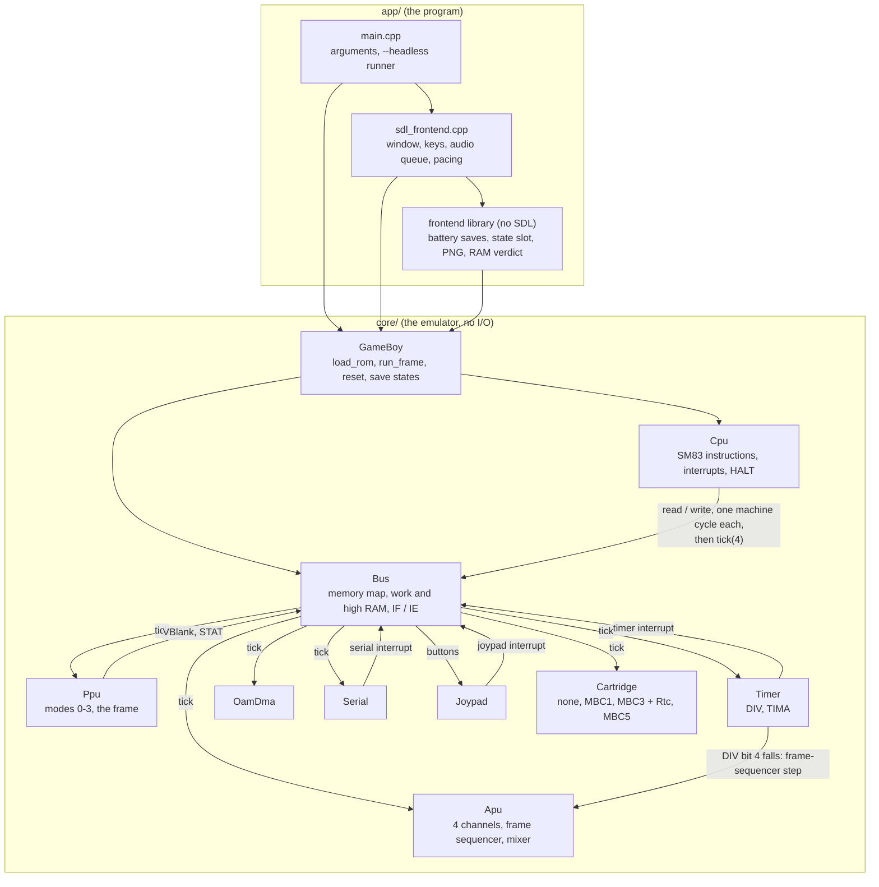

# Architecture

peasoup is two layers: `core/`, the emulator as a library with no dependencies and no I/O, and
`app/`, the program around it. Only `app/sdl_frontend.cpp` knows about SDL (ADR-002).

## How time moves

The CPU drives everything. Each memory access an instruction makes is one machine cycle: the CPU
reads or writes through the `Bus`, which then ticks every component by 4 clock ticks (ADR-005).
So the PPU, timer, APU, OAM DMA, serial port and cartridge clock all see time pass between the
accesses of a single instruction, which is what the Blargg `mem_timing` and Mooneye timing tests
measure. The frame sequencer of the APU is clocked by the falling edge of DIV bit 4, as on
hardware, so a write to DIV can step it (`docs/apu-notes.md`, section 4).

Interrupt sources set bits in IF on the bus; the CPU checks IF and IE after each opcode fetch and
dispatches (ADR-009).

## The program around it

- `main.cpp` parses the arguments and either runs a ROM headless (its serial output, or the
  verdict `dmg_sound` writes to cartridge RAM) or opens the window. The Mooneye breakpoint and the
  screenshots are checked by the test programs in `tests/`, not by the app.
- `sdl_frontend.cpp` runs one frame per loop: input, `GameBoy::run_frame()`, the picture, the
  sound. The audio queue sets the pace (ADR-025); with `--mute`, and while Tab fast-forwards,
  the wall clock does (ADR-016, ADR-027).
- The `frontend` library holds what the unit tests need without SDL: battery saves with their
  clock footer (ADR-018, ADR-019), the save-state slot, the PNG writer for screenshots, and the
  reader for verdicts written to cartridge RAM.

## Where to look

| To understand | Read |
|---|---|
| Why a design is the way it is | [DECISIONS.md](DECISIONS.md), the ADRs |
| What is verified and what is not | [accuracy.md](accuracy.md) |
| The PPU | [ppu-notes.md](ppu-notes.md) |
| Cartridges, battery saves, save states | [cartridge-notes.md](cartridge-notes.md) |
| Sound | [apu-notes.md](apu-notes.md) |
